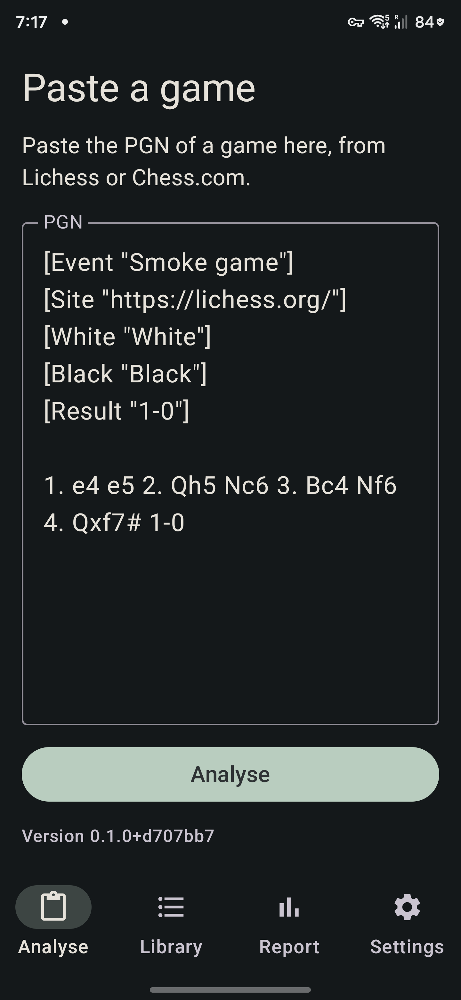
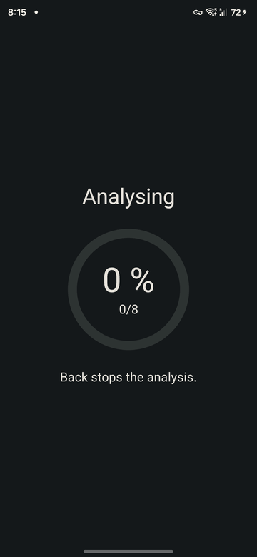

# Paste and analyse

## Pasting a game
1. Open the app. If your clipboard holds a PGN, it is filled in for you; otherwise paste one into the box (from Lichess or Chess.com).
2. Tap **Analyse**.

The version of the app is shown small on this screen.

Only standard chess is supported, and only the first game of the text is read. Comments, variations, move numbers and clock tags are ignored. A game may start from a position given in a `FEN` tag.

## When a game is refused
The app says why under the box, and nothing is analysed:
- **Paste a game first.** The box is empty.
- **This game has no moves.**
- **The starting position is not valid.**
- **Not supported.** A variant such as Chess960 or Crazyhouse; only standard chess is.
- **Illegal move N (ply M).** The game contains a move that is not legal.
- **The engine stopped before it finished. Try again.** The engine broke during the analysis.

## While it analyses

A ring fills with the percentage done, and under it a count such as `13/27` shows how many positions are finished. The percentage never goes backwards. **Back** stops the analysis and returns to the pasted game.

Every position of the game is checked (one more than the number of half-moves, because the start counts). A 27-position game takes about 20 seconds on the test phone, an 80-move game about 100 seconds.

How the engine is set up is on the [engine page](engine.md).

## Saved games
Every game you analyse is saved on the phone, in the app's own storage, and so is everything you do to it: the lines you play, their evaluations, what you edit and delete, as it happens. There is nothing to tap, and closing or killing the app loses nothing. The file is a standard SQLite database, `postmortem.sqlite`; it never leaves the phone unless you share it (see [the database](database.md)).

Pasting a game that is already saved (same moves, same start position and same tags) opens the saved one straight away, with its lines and no analysis. A short message says **Opened from your library**. A game with a changed tag or move counts as another game and is analysed again.

## The Library
The **Library** button on the paste screen (and the **Library** entry on the Settings page) opens the list of your saved games, the one you worked on last first. Each row shows the players, the result, the date and the opening, both accuracies and how many lines you played.
- **Tap a game** to open it at once on the result screen, with its lines and evals and no analysis.
- **Swipe a row to the right** to delete the game. A bar at the bottom offers **Undo** for a few seconds, which brings it back with its lines. Leaving the Library ends the offer.
- With no saved games it says **Analysed games appear here**.
- Back from the Library returns to where you came from (the paste screen with your text kept, or the Settings page).
