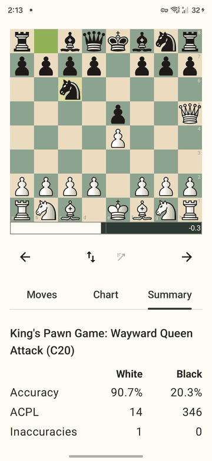

# Engine

## Stockfish
Postmortem runs Stockfish 19 (tag `sf_19`) on the phone, built from source with the Android NDK. It starts as a separate process; no network is used.

## The analysis is repeatable
Each position gets **1,000,000 nodes** from a single-threaded engine with a cleared 16 MB hash. A budget of nodes, not of time, means the same game gets the same evaluations every time, on the phone, on a slower phone, or while you use the phone for something else. Speed comes from running up to four such engines on different positions at once (one core is left for the system).

The settings are shown at the bottom of the Summary and are defined in `AnalysisConfig`.

## Live arrows
The result screen shows what the engine thinks of the position on the board, as arrows:
- Up to **three** arrows, the best three moves. The best is the thickest and most opaque.
- A small label at the head of each arrow gives the evaluation **from the side to move's point of view**, e.g. `+0.4` or `−1.2`, `#2` for a mate.
- They appear when you stay on a position for a moment (about 0.3 s); stepping quickly does not start searches. A position you saw before is answered at once.
- The search stops by itself after 20 seconds, and when the app goes to the background.
- All three lines always come from the same search depth, so two arrows never point at the same move.

**Tap the engine button** (next to the flip button) to turn the arrows off or on. The choice is kept when you close the app. Off, the engine does no work, which saves battery.

**Long-press the engine button** to show a one-line readout under the board: the depth reached, the speed in kilonodes per second, and whether it is still searching or done. Long-press again to hide it.

The live search uses its own engine process (2 threads, 64 MB hash), separate from the analysis, so it never changes the evaluations in the chart and the summary.

## Known limits
- The live arrows are not repeatable: they depend on how long you wait.
- Heat and battery use while the arrows are on are measured in [#104](https://github.com/pmortem/postmortem/issues/104).
