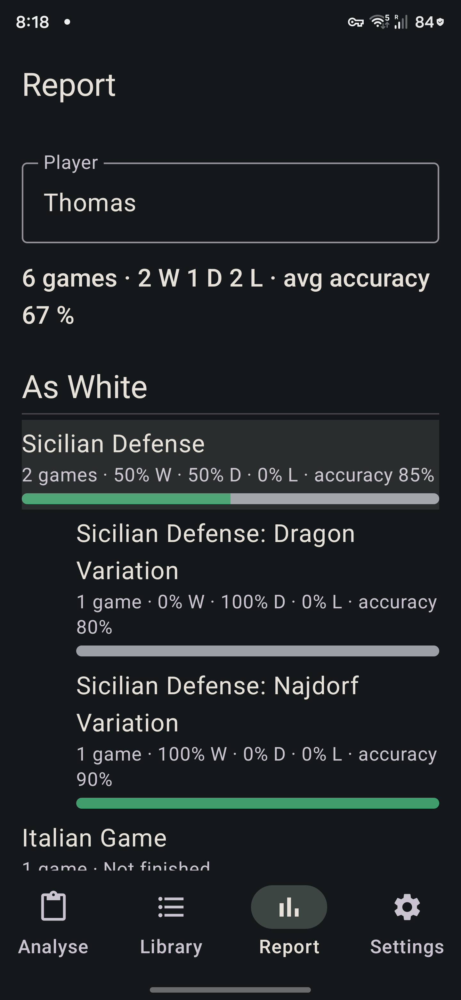
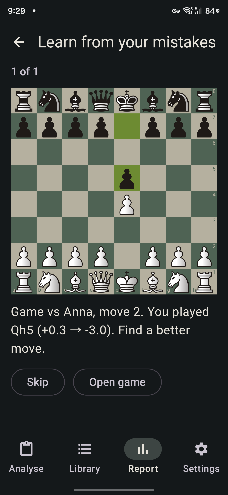

# Report

The **Report** tab looks across every game saved in the active [database](database.md) for one player. Only games you have analysed count, and only the ones in the database that is open. It shows the player's openings and the wins they missed, and has a practice mode made from the player's own mistakes.

## Picking a player
Type a name in the **Player** field, or tap one of the suggestions under it. The suggestions are the names in the White and Black tags of your saved games, the one with most games first, with the number of games in brackets, for example `Thomas (23)`.

- Names match without regard to capital letters, and spaces at the start and end are ignored.
- Games with no name (`?` or empty) are left out.
- The last name you picked is remembered, also after the app is closed.
- If the database has no games, the tab says **Analyse some games first**. If it has games but no names, or none for the name you typed, it says so.

## Filters and tabs
Under the player field are two rows of chips, the **filters**, and under them four **tabs**: **Overview**, **Openings**, **Mistakes** and **Practice**. Every tab follows the filters, and so do the numbers in it (the overview line, the openings, the missed wins and the practice queue and its count). The choice is remembered with the player: it is still there after you switch tabs, open a game and come back, or restart the app.

- **Period:** **All**, **Last 30 days** or **Last 100 games**. The days come from the game's `Date` tag; when the tag says nothing, the day the game was saved is used. The last 100 games are the newest by that day, then by the order they were saved, among the games the time control lets through (so "Last 100 games" with "Blitz" is your last 100 blitz games).
- **Time control:** **All**, **Bullet**, **Blitz**, **Rapid** or **Classical**. It is worked out from the game's `TimeControl` tag the way Lichess does: the base time plus 40 times the increment, in seconds. Under 180 seconds is bullet, under 480 blitz, under 1500 rapid, and anything longer classical. For example `60+0` is bullet, `180+2` is blitz (260 seconds), `600+5` is rapid (800) and `1800+0` is classical. A game of days per move (`1/259200`, chess.com's daily games) counts as classical.
- **Unknown time control:** a game with no `TimeControl` tag, or a `-`, belongs to no time control. It shows under **All** only.
- If no game is left for the filters, the Report says **No games for these filters**.

- **Overview:** the overview line below. Charts are coming.
- **Openings:** the two sections below.
- **Mistakes:** the missed wins and missed mates.
- **Practice:** the Learn from your mistakes button.

## The overview
One line under the field: the number of games, how many were won, drawn and lost, and the average accuracy of the games that have one, for example `23 games · 11 W 4 D 8 L · avg accuracy 78 %`. The accuracy is the player's own, as shown in the [Summary](summary.md).

## Openings
Two sections, **As White** and **As Black**. Each row is an opening family: the name before the first colon of the opening's name, for example `Sicilian Defense`. A row shows the number of games, how they ended as percentages (W, D, L, with a small bar of green, grey and red), and the average accuracy. The rows are sorted by games, the most played first; games with no detected opening are listed last as **Unknown opening**.

- **Percentages** are counted over the finished games. A game whose result is `*` or missing counts in the number of games, but not in the percentages (a row with only such games says "Not finished").
- **Tap a family** to open its variations, with the same numbers. A family with a single variation has no list: tapping it goes straight to its games.
- **Tap a variation** to see its games: the opponent, the result, the date and the accuracy. Tap a game to open it as from the [Library](analysis.md#the-library). Back returns to the Report with the list where it was; Back once more leaves the Report tab for Analyse.

The numbers are worked out again each time the tab opens, so a game analysed or deleted since then is counted.

## Missed wins
Below the openings, a card about converting winning positions, the first of the "mistakes you keep making" insights.

- **A missed win** is a game of the player's where, after **two of their moves in a row**, they were clearly winning (winning chances of at least 50 % on the chart scale, about +3.0 pawns, or a forced mate for them), and which they then **drew or lost**. Games without a result are left out.
- The **turning move** is the player's move after the best moment of that win that lost the most winning chances. It normally has a `?` or `??` mark in the Moves tab too.
- **A missed mate** is a position where the player had a forced mate in at most **5 moves** and the move they played left no mate for them. It is listed even when the game was won, as on Lichess. A mate that was kept (even if it got longer) or delivered is not missed.

The card says `Missed wins: 4 of 19 decided games (21 %)` and `Missed mates: 3`, then lists the games newest first: the opponent, the date, your colour, the peak evaluation from your side (`+4.2`), the turning move with its number and mark (`31.Qxb7??`), the evaluation after it, and how the game ended. A missed mate says `had mate in 3, played 12.Qh5`. Tap a row to open the game at that move, as from the [Library](analysis.md#the-library); Back returns to the Report.

The numbers come from the evaluations stored with each game, so a game must have been analysed (every game in the Library has been). The thresholds (50 %, two moves, five moves) are named constants in the code and can be tuned.

## Learn from your mistakes
The **Learn from your mistakes** button, at the top of the Report, is a quiz made of your own games, like Lichess's "Learn from your mistakes" but across every game in the database. Under the button it says how many positions are still to go and how many you have solved, for example `12 to go · 5 solved`.

**Which positions.** The position before each move of yours that was marked `?` (a mistake) or `??` (a blunder), where the marks are the ones of the [Moves tab](result-screen.md). Inaccuracies are left out. They come in this order: the turning moves of your missed wins and your missed mates first, then blunders, then mistakes, the newest game first within each. Solved positions leave the queue. Positions you failed or skipped come back after the others, the one tried longest ago first.

**The question.** The board shows the position from your side, with the opponent's last move marked, and says `Game vs Anna, move 31. You played Qxb7 (+4.2 → -1.3). Find a better move.` Play a move on the board as you would on the result screen (tap, or drag). While it is being checked a small spinner shows and nothing else can be touched. The answer is:
- **Right!** when it is the engine's best move for that position.
- **Good move, but there's a better one** when it is not, but your winning chances after it fall by less than an inaccuracy would (Lichess's rule, the same limit as the marks), so it is nearly as good. An arrow shows the best move, and the position counts as solved.
- **Not this one** otherwise. The move is taken back. **Try again** asks the same position again; **Show** shows the best move with an arrow and its evaluation and counts the position as failed for now.

**Always there:** **Skip** (counts as a try that is not solved), **Next** after an answer, **Open game** (opens the game on the result screen at that move, and ends the practice) and the back arrow. At the end of the queue it says `All done: 3 solved, 2 to try again`, with **Start over with the failed ones**.

**The engine.** One engine process at most. A move other than the stored best move is checked with the same settings as the game's analysis (fixed nodes, one thread), so a position has one value whenever it is checked. Games analysed before best moves were kept get theirs when a position of theirs is first asked, and keep it. The live arrows are off here.

**Progress** is stored in the database file (the `drill` table, see [the database](database.md)): it survives restarts, goes with the file when you export it, and is merged with it when you import one. Deleting a game deletes its progress.

## How the numbers are worked out
The charts and tiles of the Overview use these rules. They are the same for every game, and the accuracy and the marks of each game are the ones its own Summary tab shows.

- **Score %:** a win is 1 point and a draw half a point, divided by the games that were decided. A game with no result (`*`) is a game but is left out of every percentage.
- **ACPL and the marks per game:** average centipawn loss and the inaccuracies, mistakes and blunders of the player's own moves, as in the Summary tab. They need the stored evaluations; a game without them still counts in the totals and the groups.
- **By time control:** bullet, blitz, rapid, classical, and a group for games with no time control, each with its games, score and average accuracy.
- **By opponent strength:** the opponent's Elo minus the player's. **Stronger** is 100 or more, **weaker** is 100 or less below, **equal** is in between, and **unknown** when either Elo is missing.
- **By phase:** each of the player's moves belongs to the phase of the position it was played in. It is the **opening** while the opening book still knows the position or during the first 12 moves, even if queens come off. After that it is an **endgame** when there are no queens left or each side has at most 13 points of pieces (knight and bishop 3, rook 5, queen 9; pawns and kings do not count), and the **middlegame** otherwise. Each phase shows the number of moves, the average centipawn loss and the marks.
- **How games ended:** for each of won, lost and drawn, how many ended by checkmate, resignation, time, agreement, stalemate, repetition or insufficient material, or some other way. The last position comes first (a checkmate, a stalemate, too little material, a position three times), then the `Termination` tag (Lichess writes `Normal` or `Time forfeit`; chess.com writes things like `won by resignation`), then the result: a decisive game that is not a mate and not on time counts as a resignation and a drawn one as an agreement. When nothing fits it is "other".
- **Trend:** one point per game, oldest first, with the average accuracy of that game and the nine before it (fewer at the start).
