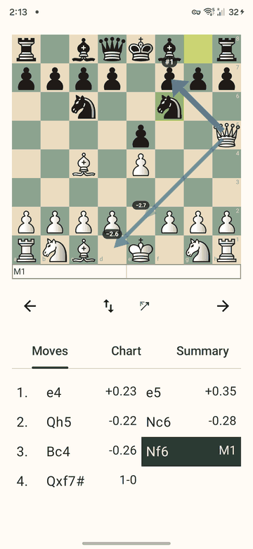
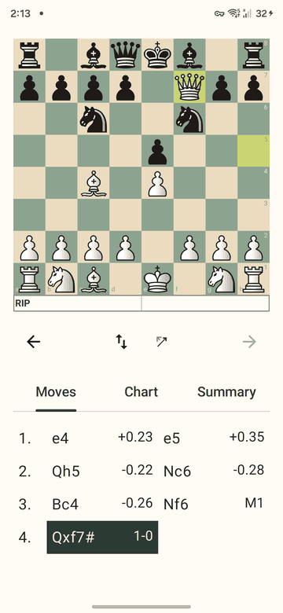
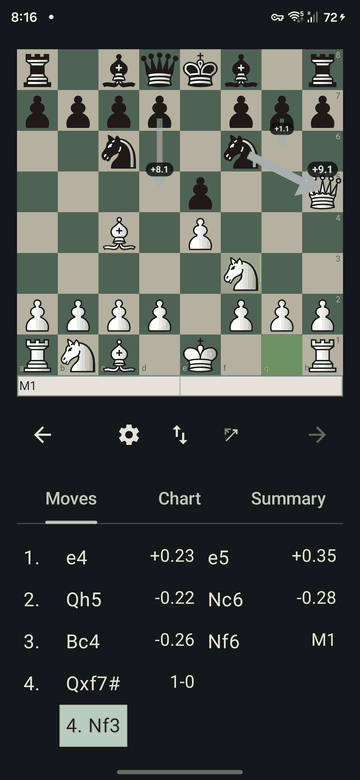
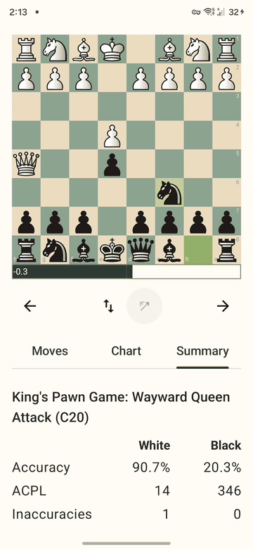
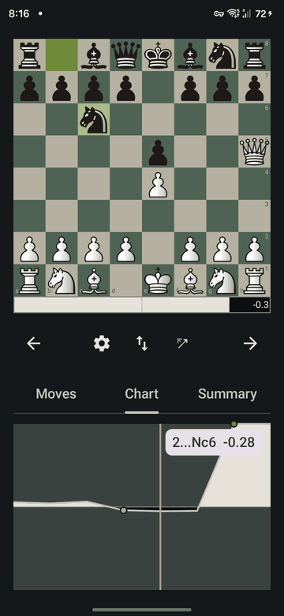

# The result screen

When the analysis is done you see the board, an eval bar, a row of buttons, and three tabs under them.

## Board
- White is at the bottom, with the coordinates in the corners of the squares like in the Lichess app.
- The two squares of the move that led to the shown position are tinted yellow-green. At the start position nothing is tinted. Castling tints the king's squares, en passant the capturing pawn's, a promotion the pawn's.

## Playing your own moves
Ask "what if I had played this?" by moving a piece on the board:
- **Tap a piece** of the side to move: its square is tinted and its legal moves show as dots (a ring where it captures). Tap a dot to play it. Tap the piece again, another piece, or anywhere else to change or cancel.
- **Or drag** the piece to a square. If the move is legal it is played; if not, the piece snaps back.
- A pawn reaching the last rank opens a small picker (queen, rook, bishop, knight) over its square. Tap a piece to promote, tap elsewhere or press Back to cancel.
- Only legal moves are accepted. It works with the board flipped.

What a move does:
- The game's own next move just steps forward.
- Any other move from a game position starts a **line**: its own indented row in the Moves tab, under the full move where it branches, written like `3... Nf6 4. Nf3 Qe7`. The new line is selected.
- A move at the end of a line extends it. A move in the middle of a line starts another line from the same game position, with the line's earlier moves copied in. Playing the same move again selects the line that already has it.
- ← and → walk along the line; ← at its first move goes back to the game position it branched from. **Back** from a line also goes to that position.
- The chart marks the position the line branches from, and the Summary is always about the game. Lines have no evaluations yet: the eval bar shows the branch position's.

## Eval bar
A horizontal bar right under the board. The side at the bottom of the board fills from the left. The number is the evaluation from White's point of view: `+0.35` is a small edge for White, `M3` a forced mate in 3. On the last position of the game the bar says **RIP**, whatever the ending.

## Buttons
- **← and →** step to the previous or next move. The arrow that cannot go further is dimmed.
- **Settings** (the cog, left of the flip button) opens the Settings page. It is empty for now: only a top bar with the title and a back arrow. The back arrow or the system Back returns to the same game, move, tab and board side.
- **Flip** (up-down arrows) turns the board around so Black is at the bottom. The bar, the tint and the arrows follow.
- **Engine arrows** (the diagonal arrow) turns the live engine's arrows on and off. See the [engine page](engine.md). A long press shows or hides a readout of the search.

## Tabs
Switching tabs never changes the board or the selected move.

### Moves
Every move with its evaluation, two moves per row. Tap a move to show it on the board. The selected one is highlighted. Lines you played appear as indented rows under the move where they branch (see above); tap any move in one to show it.

### Chart

The evaluation over the whole game: White's advantage fills above the middle line, Black's below it. Tap or drag anywhere to select a move; the board follows, and a label next to the marker names the move (`4.Qxf7#`) and its evaluation. Dots mark inaccuracies, mistakes and blunders, and the label adds `?!`, `?` or `??` after a move that was one.

### Summary
See the [summary page](summary.md).
