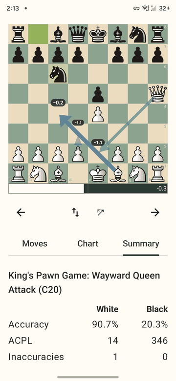

# Summary

The Summary tab shows, from the PGN tags: the players (with ratings), the date, event, site, result and how the game ended. If the moves match one, the **opening** is named with its ECO code, for example `King's Pawn Game: Wayward Queen Attack (C20)`.

Under it, one column per side:
- **Accuracy**: how close the moves were to the engine's best, in percent. It is the Lichess accuracy: the same formulas and constants, so that the same evaluations give the same number.
- **ACPL**: average centipawn loss per move.
- **Inaccuracies, mistakes, blunders**: moves that lose a lot of winning chances. Lichess's thresholds: a drop of 10, 20 or 30 percentage points in win chance.

At the bottom, small, are the engine and the settings the game was analysed with.

## Compared with Lichess
For the same evaluations the numbers are exactly Lichess's. Our evaluations come from our own repeatable search, so a single move can sit on the other side of a threshold (for one test game, one inaccuracy). This is search noise, not a formula difference ([#88](https://github.com/pmortem/postmortem/issues/88)).
